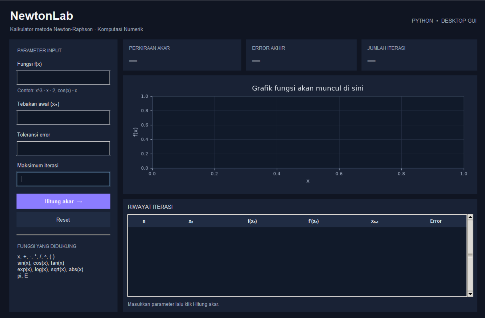
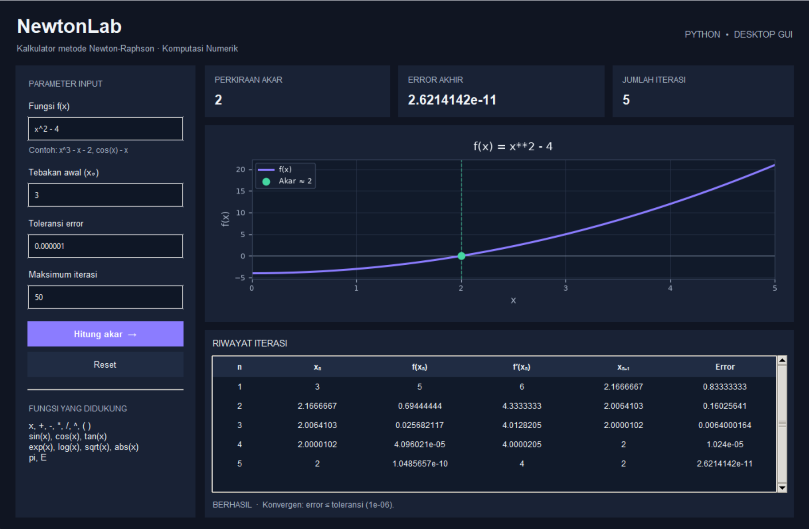

<div align="center">

# 🧮 NewtonLab

### Kalkulator Penyelesaian Persamaan Nonlinier dengan Metode **Newton-Raphson**

*Project UTS Praktikum Komputasi Numerik C*




</div>

---

## 📑 Daftar Isi

- [✨ Fitur](#-fitur)
- [🎯 Tentang Metode Newton-Raphson](#-tentang-metode-newton-raphson)
- [🚀 Cara Menjalankan](#-cara-menjalankan)
- [🕹️ Cara Menggunakan](#️-cara-menggunakan)
- [🧪 Contoh Kasus](#-contoh-kasus)
- [🧠 Penjelasan Kode](#-penjelasan-kode)
- [📁 Struktur Repository](#-struktur-repository)
- [👥 Anggota Kelompok](#-anggota-kelompok)

---

## ✨ Fitur

| Fitur | Keterangan |
|---|---|
| ✍️ **Input fungsi bebas** | Ketik f(x) sendiri, misalnya `x^3 - x - 2` atau `cos(x) - x` |
| ⚙️ **Parameter fleksibel** | Tebakan awal (x₀), toleransi error, dan maksimum iterasi |
| 📊 **Kartu ringkasan** | Perkiraan akar, error akhir, dan jumlah iterasi tampil di bagian atas |
| 📋 **Riwayat iterasi** | Tabel n, xₙ, f(xₙ), f′(xₙ), xₙ₊₁, dan error di setiap langkah |
| 📈 **Grafik fungsi** | Kurva f(x), garis sumbu x, serta penanda titik akar yang ditemukan |
| 🧮 **Turunan otomatis** | f′(x) dihitung secara simbolik oleh SymPy, tidak perlu input manual |
| 🛑 **Kriteria berhenti** | Berhenti saat error ≤ toleransi **atau** iterasi mencapai batas maksimum |
| ✅ **Status konvergensi** | Pesan status di bawah tabel, misalnya "BERHASIL · Konvergen: error ≤ toleransi" |
| 💡 **Panduan input** | Contoh fungsi dan daftar fungsi yang didukung langsung di panel input |
| 🛡️ **Validasi input** | Pesan kesalahan jelas untuk fungsi kosong, format salah, toleransi ≤ 0, dan turunan mendekati nol |
| 🌙 **Tampilan dark mode** | Antarmuka modern dengan aksen ungu |

---

🎯 Tentang Metode Newton-Raphson
Metode Newton-Raphson mencari akar f(x) = 0 dengan memakai garis singgung kurva sebagai pendekatan. Mulai dari tebakan awal x₀, setiap iterasi memperbaiki tebakan dengan rumus:
```
xₙ₊₁ = xₙ − f(xₙ) / f′(xₙ)
```
Error dihitung sebagai selisih mutlak dua tebakan berurutan:
```
error = |xₙ₊₁ − xₙ|
```
```mermaid
flowchart TD
    A(\[Mulai]) --> B\[/Input f x, x0, toleransi, maks iterasi/]
    B --> C\[Hitung f' x secara simbolik]
    C --> D\[Hitung f xn dan f' xn]
    D --> E{abs f' xn < 1e-14 ?}
    E -- Ya --> F\[/Error: turunan mendekati nol/]
    E -- Tidak --> G\["xn+1 = xn - f xn / f' xn"]
    G --> H\["error = abs xn+1 - xn"]
    H --> I{error <= toleransi ?}
    I -- Ya --> J\[Akar ditemukan]
    I -- Tidak --> K{iterasi = maksimum ?}
    K -- Ya --> J
    K -- Tidak --> D
    J --> L\[/Tampilkan akar, tabel iterasi, grafik/]
    L --> M(\[Selesai])
```
<details>
<summary><b>💡 Kelebihan dan keterbatasan (klik untuk membuka)</b></summary>
Kelebihan
Konvergensi sangat cepat (kuadratik) bila tebakan awal dekat dengan akar.
Hanya butuh satu tebakan awal, bukan interval.
Keterbatasan
Gagal jika f′(xₙ) = 0 atau mendekati nol.
Bisa divergen atau menuju akar yang tidak diinginkan jika x₀ kurang tepat.
Membutuhkan fungsi yang dapat diturunkan.
</details>
---
🚀 Cara Menjalankan
1. Clone repository
```bash
git clone https://github.com/<username>/<nama-repository>.git
cd <nama-repository>
```
2. Buat dan aktifkan virtual environment
```bash
python -m venv .venv
```
Aktifkan sesuai sistem operasi:
```bash
.venv\\Scripts\\activate           # Windows
source .venv/bin/activate        # macOS / Linux
```
> 💡 \*\*Windows PowerShell\*\* kadang menolak aktivasi dengan error \*"running scripts is disabled on this system"\*. Jalankan sekali perintah berikut, lalu ulangi aktivasi:
> ```powershell
> Set-ExecutionPolicy -Scope CurrentUser RemoteSigned
> ```
> Alternatifnya, gunakan \*\*Command Prompt\*\* (CMD).
3. Instal library
```bash
pip install -r requirements.txt
```
> `tkinter` sudah termasuk dalam instalasi Python standar. Pengguna Linux dapat memasangnya dengan `sudo apt install python3-tk`.
4. Jalankan program
```bash
python main.py
```
<details>
<summary><b>🧰 Menjalankan lewat VS Code (klik untuk membuka)</b></summary>
Buka folder project dengan File → Open Folder.
Tekan `Ctrl+Shift+P`, pilih Python: Select Interpreter, lalu pilih `.venv`.
Buka `main.py`, lalu klik tombol ▶ Run Python File.
</details>
---
## 🕹️ Cara Menggunakan

1. **Masukkan fungsi f(x)** pada kolom *Fungsi f(x)*.
2. Isi **tebakan awal (x₀)**.
3. Tentukan **toleransi error** dan **maksimum iterasi**.
4. Klik tombol **Hitung akar**.
5. Lihat kartu ringkasan, grafik, dan riwayat iterasi pada panel hasil.
6. Klik **Reset** untuk mengembalikan tampilan seperti semula.

<details>
<summary><b>📝 Aturan penulisan fungsi (klik untuk membuka)</b></summary>

| Yang didukung | Contoh |
|---|---|
| Operator | `+`  `-`  `*`  `/`  `^` (pangkat)  `( )` |
| Fungsi | `sin(x)`  `cos(x)`  `tan(x)`  `asin(x)`  `acos(x)`  `atan(x)`  `exp(x)`  `log(x)`  `sqrt(x)`  `abs(x)` |
| Konstanta | `pi`  `E` |

Contoh penulisan yang valid:

```
x^3 - x - 2
cos(x) - x
exp(x) - 3*x
sqrt(x) - 2
```

</details>

---

## 🧪 Contoh Kasus

**Soal:** cari akar dari f(x) = x² − 4

| Parameter | Nilai |
|---|---|
| f(x) | `x^2 - 4` |
| Tebakan awal (x₀) | `3` |
| Toleransi error | `0.000001` |
| Maksimum iterasi | `50` |

**Hasil:** akar **x ≈ 2** ditemukan dalam **5 iterasi** dengan error akhir **2,62 × 10⁻¹¹**, jauh di bawah toleransi 10⁻⁶.

<div align="center">



</div>

### 📋 Riwayat Iterasi

| n | xₙ | f(xₙ) | f′(xₙ) | xₙ₊₁ | Error |
|:-:|:-:|:-:|:-:|:-:|:-:|
| 1 | 3 | 5 | 6 | 2,1666667 | 0,83333333 |
| 2 | 2,1666667 | 0,69444444 | 4,3333333 | 2,0064103 | 0,16025641 |
| 3 | 2,0064103 | 0,025682117 | 4,0128205 | 2,0000102 | 0,0064000164 |
| 4 | 2,0000102 | 4,096021e-05 | 4,0000205 | 2 | 1,024e-05 |
| 5 | 2 | 1,0485657e-10 | 4 | 2 | 2,6214142e-11 |

Terlihat error mengecil sangat cepat di setiap iterasi, ciri khas konvergensi kuadratik pada metode Newton-Raphson.

<details>
<summary><b>🔍 Hitungan manual iterasi pertama (klik untuk membuka)</b></summary>

Dengan f(x) = x² − 4, maka f′(x) = 2x dan x₀ = 3:

```
f(3)  = 3² − 4 = 5
f′(3) = 2·3    = 6

x₁ = 3 − 5/6 ≈ 2,1666667
error = |2,1666667 − 3| ≈ 0,8333333
```

Hasil ini sama dengan baris pertama pada tabel di atas.

</details>

---

