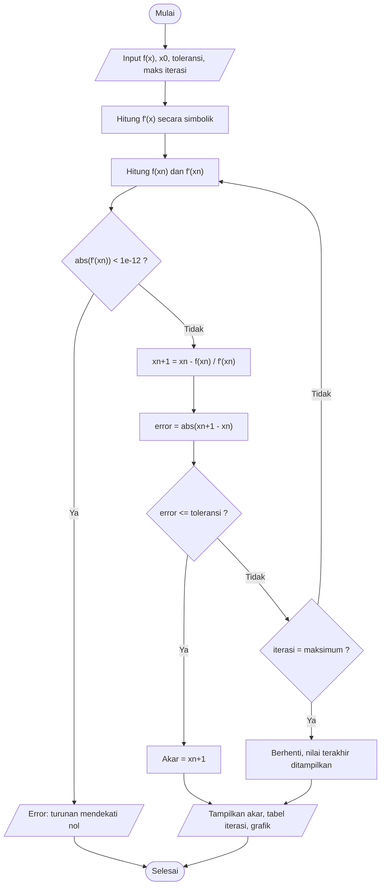

<div align="center">

# 🧮 NewtonLab

### Kalkulator Penyelesaian Persamaan Nonlinier dengan Metode **Newton-Raphson**

*Project UTS Praktikum Komputasi Numerik C*


</div>

---

## 📑 Daftar Isi

- [✨ Fitur](#-fitur)
- [🎯 Tentang Metode Newton-Raphson](#-tentang-metode-newton-raphson)
- [🚀 Cara Menjalankan](#-cara-menjalankan)
- [🕹️ Cara Menggunakan](#️-cara-menggunakan)
- [🧪 Contoh Kasus](#-contoh-kasus)
- [🧠 Penjelasan Kode](#-penjelasan-kode)
- [📁 Struktur Repository](#-struktur-repository)
- [👥 Anggota Kelompok](#-anggota-kelompok)

---

## ✨ Fitur

| Fitur | Keterangan |
|---|---|
| ✍️ **Input fungsi bebas** | Ketik f(x) sendiri, misalnya `x^3 - x - 2` atau `cos(x) - x` |
| ⚙️ **Parameter fleksibel** | Tebakan awal (x₀), toleransi error, dan maksimum iterasi dapat diatur |
| 🧮 **Turunan otomatis** | f′(x) dihitung secara simbolik oleh SymPy, tidak perlu input manual |
| 📋 **Riwayat iterasi** | Tabel n, xₙ, f(xₙ), f′(xₙ), xₙ₊₁, dan error di setiap langkah |
| 🎯 **Hasil akar** | Perkiraan akar ditampilkan di atas tabel dengan 10 angka desimal |
| 📈 **Grafik fungsi** | Kurva f(x), garis sumbu x, dan penanda titik akar yang ditemukan |
| 🛑 **Kriteria berhenti** | Berhenti saat error ≤ toleransi **atau** iterasi mencapai batas maksimum |
| 🛡️ **Validasi input** | Pesan kesalahan untuk fungsi kosong, format fungsi tidak valid, toleransi ≤ 0, maksimum iterasi < 1, dan turunan mendekati nol |
| 🔄 **Tombol Reset** | Mengembalikan input ke nilai awal dan mengosongkan hasil |
| 🌙 **Tampilan gelap** | Latar jendela gelap dengan aksen ungu |

---

## 🎯 Tentang Metode Newton-Raphson

Metode Newton-Raphson mencari akar f(x) = 0 dengan memakai **garis singgung** kurva sebagai pendekatan. Mulai dari tebakan awal x₀, setiap iterasi memperbaiki tebakan dengan rumus:

```
xₙ₊₁ = xₙ − f(xₙ) / f′(xₙ)
```

Error dihitung sebagai selisih mutlak dua tebakan berurutan:

```
error = |xₙ₊₁ − xₙ|
```



<details>
<summary><b>💡 Kelebihan dan keterbatasan (klik untuk membuka)</b></summary>

**Kelebihan**
- Konvergensi sangat cepat (kuadratik) bila tebakan awal dekat dengan akar.
- Hanya butuh satu tebakan awal, bukan interval.

**Keterbatasan**
- Gagal jika f′(xₙ) = 0 atau mendekati nol.
- Bisa divergen atau menuju akar yang tidak diinginkan jika x₀ kurang tepat.
- Membutuhkan fungsi yang dapat diturunkan.

**Catatan pada program ini**
- Jika iterasi mencapai batas maksimum sebelum error ≤ toleransi, program tetap menampilkan nilai terakhir tanpa pesan peringatan khusus. Periksa kolom *Error* pada tabel untuk memastikan hasil sudah konvergen.

</details>

---

## 🚀 Cara Menjalankan

### 1. Clone repository

```bash
git clone https://github.com/yuenothingelse/NewtonLab.git
cd NewtonLab
```

### 2. Buat dan aktifkan virtual environment

```bash
python -m venv .venv
```

Aktifkan sesuai sistem operasi:

```bash
.venv\Scripts\activate           # Windows
source .venv/bin/activate        # macOS / Linux
```

> 💡 **Windows PowerShell** kadang menolak aktivasi dengan error *"running scripts is disabled on this system"*. Jalankan sekali perintah berikut, lalu ulangi aktivasi:
> ```powershell
> Set-ExecutionPolicy -Scope CurrentUser RemoteSigned
> ```
> Alternatifnya, gunakan **Command Prompt** (CMD).

### 3. Instal library

```bash
pip install -r requirements.txt
```

> `tkinter` sudah termasuk dalam instalasi Python standar. Pengguna Linux dapat memasangnya dengan `sudo apt install python3-tk`.

### 4. Jalankan program

```bash
python main.py
```

<details>
<summary><b>🧰 Menjalankan lewat VS Code (klik untuk membuka)</b></summary>

1. Buka folder project dengan **File → Open Folder**.
2. Tekan `Ctrl+Shift+P`, pilih **Python: Select Interpreter**, lalu pilih `.venv`.
3. Buka `main.py`, lalu klik tombol **▶ Run Python File**.

</details>

---

## 🕹️ Cara Menggunakan

1. **Masukkan fungsi f(x)** pada kolom *Fungsi f(x)*.
2. Isi **tebakan awal (x₀)**.
3. Tentukan **toleransi error** dan **maksimum iterasi**.
4. Klik tombol **Hitung Akar**.
5. Lihat perkiraan akar, tabel riwayat iterasi, dan grafik pada panel *Hasil Perhitungan*.
6. Klik **Reset** untuk mengembalikan input ke nilai awal dan mengosongkan hasil.

Nilai awal pada kolom input adalah `x^2 - 4`, `3`, `0.000001`, dan `50`.

<details>
<summary><b>📝 Aturan penulisan fungsi (klik untuk membuka)</b></summary>

| Yang didukung | Contoh |
|---|---|
| Operator | `+`  `-`  `*`  `/`  `^` (pangkat)  `( )` |
| Fungsi | `sin(x)`  `cos(x)`  `tan(x)`  `exp(x)`  `log(x)`  `sqrt(x)`  `abs(x)` |
| Konstanta | `pi`  `E` |

> `log(x)` adalah logaritma natural (ln x). Sudut pada fungsi trigonometri dalam satuan radian.

Contoh penulisan yang valid:

```
x^3 - x - 2
cos(x) - x
exp(x) - 3*x
sqrt(x) - 2
```

</details>

---

## 🧪 Contoh Kasus

**Soal:** cari akar dari f(x) = x² − 4

| Parameter | Nilai |
|---|---|
| f(x) | `x^2 - 4` |
| Tebakan awal (x₀) | `3` |
| Toleransi error | `0.000001` |
| Maksimum iterasi | `50` |

**Hasil:** akar **x ≈ 2** ditemukan dalam **5 iterasi**, dengan error pada iterasi terakhir sekitar 2,62 × 10⁻¹¹, jauh di bawah toleransi 10⁻⁶.

<div align="center">


</div>

### 📋 Riwayat Iterasi

Nilai pada tabel program ditampilkan dengan 8 angka desimal.

| n | xₙ | f(xₙ) | f′(xₙ) | xₙ₊₁ | Error |
|:-:|:-:|:-:|:-:|:-:|:-:|
| 1 | 3.00000000 | 5.00000000 | 6.00000000 | 2.16666667 | 0.83333333 |
| 2 | 2.16666667 | 0.69444444 | 4.33333333 | 2.00641026 | 0.16025641 |
| 3 | 2.00641026 | 0.02568212 | 4.01282051 | 2.00001024 | 0.00640002 |
| 4 | 2.00001024 | 0.00004096 | 4.00002048 | 2.00000000 | 0.00001024 |
| 5 | 2.00000000 | 0.00000000 | 4.00000000 | 2.00000000 | 0.00000000 |

Terlihat error mengecil sangat cepat di setiap iterasi, ciri khas konvergensi kuadratik pada metode Newton-Raphson.

<details>
<summary><b>🔍 Hitungan manual iterasi pertama (klik untuk membuka)</b></summary>

Dengan f(x) = x² − 4, maka f′(x) = 2x dan x₀ = 3:

```
f(3)  = 3² − 4 = 5
f′(3) = 2·3    = 6

x₁ = 3 − 5/6 ≈ 2,1666667
error = |2,1666667 − 3| ≈ 0,8333333
```

Hasil ini sama dengan baris pertama pada tabel di atas.

</details>

---

## 🧠 Penjelasan Kode

Seluruh program ada di `main.py`.

<details>
<summary><b>📦 Library yang digunakan</b></summary>

| Library | Fungsi |
|---|---|
| `tkinter` / `ttk` | Membangun antarmuka GUI (kolom input, tombol, tabel) |
| `sympy` | Mengubah teks menjadi ekspresi matematika dan menurunkan fungsi |
| `numpy` | Mengevaluasi fungsi pada banyak titik untuk membuat grafik |
| `matplotlib` | Menggambar grafik dan menyisipkannya ke Tkinter lewat `FigureCanvasTkAgg` |

</details>

<details>
<summary><b>🔤 Membaca fungsi dari input pengguna (<code>parse_function</code>)</b></summary>

Teks yang diketik pengguna diubah menjadi ekspresi SymPy.

- Input kosong ditolak dengan pesan *"Fungsi f(x) tidak boleh kosong."*
- Tanda `^` diganti menjadi `**` agar pangkat dikenali Python.
- Fungsi yang dikenali: `sin`, `cos`, `tan`, `exp`, `log`, `sqrt`, `abs`, serta konstanta `pi` dan `E`.
- Format yang tidak valid memunculkan pesan *"Format fungsi tidak valid."*

</details>

<details>
<summary><b>🎨 Antarmuka (<code>NewtonRaphsonApp</code>)</b></summary>

Tampilan dibangun dengan Tkinter (tema `clam`) berlatar gelap dan tombol beraksen ungu. Susunannya:

- **Panel kiri, *Parameter Perhitungan*:** kolom input (fungsi, tebakan awal, toleransi, maksimum iterasi), tombol *Hitung Akar* dan *Reset*.
- **Panel kanan, *Hasil Perhitungan*:** label hasil akar di bagian atas, tabel riwayat iterasi di tengah, dan grafik Matplotlib di bagian bawah.

</details>

<details>
<summary><b>⚙️ Inti metode Newton-Raphson (<code>calculate_newton_raphson</code>)</b></summary>

1. Menurunkan fungsi dengan `sp.diff`.
2. Mengubah f(x) dan f′(x) menjadi fungsi numerik dengan `sp.lambdify`.
3. Mengulang dari n = 1 sampai maksimum iterasi:
   - menghitung `f(xₙ)` dan `f′(xₙ)`,
   - berhenti dengan pesan kesalahan jika `|f′(xₙ)| < 1e-12`,
   - menghitung `x_next = xn - fx / dfx`,
   - menghitung `error = |x_next - xn|`,
   - menyimpan semua nilai ke daftar iterasi,
   - berhenti jika `error <= toleransi`.
4. Mengembalikan akar, seluruh riwayat iterasi, dan turunan fungsi.

</details>

<details>
<summary><b>📈 Pembuatan grafik (<code>plot_function</code>)</b></summary>

Kurva f(x) digambar pada rentang `akar − 5` sampai `akar + 5` dengan 500 titik, bersama garis sumbu x dan penanda titik akar. Grafik diberi judul *"Grafik Fungsi"*, label sumbu, grid, dan legenda.

</details>

<details>
<summary><b>▶️ Tombol Hitung Akar dan Reset</b></summary>

- **Hitung Akar** (`calculate`) membaca semua input, memvalidasi (toleransi harus > 0, iterasi minimal 1), menjalankan metode, lalu mengisi label akar, tabel, dan grafik. Kesalahan ditampilkan lewat jendela peringatan.
- **Reset** (`reset`) mengembalikan input ke nilai awal, mengosongkan tabel dan grafik, serta mengubah label hasil menjadi *"Belum ada hasil."*

</details>

---

## 📁 Struktur Repository

```
📦 NewtonLab
 ┣ 📂 assets
 ┃ ┣ 🖼️ screenshot.png
 ┃ ┗ 🖼️ hasil-perhitungan.png
 ┣ 📜 LICENSE
 ┣ 📜 main.py
 ┣ 📜 requirements.txt
 ┗ 📜 README.md
```

Isi `requirements.txt`:

```
numpy
sympy
matplotlib
```

---

## 👥 Anggota Kelompok

**Kelompok:** 6 &nbsp;|&nbsp; **Kelas:** C

| No | Nama | NIM |
|---|---|---|
| 1 | Tiara Balqis | 250810701100074 |
| 2 | Annisa Fadhilah | 250810701100086 |
| 3 | Mirza Nur Akhyar | 250810701100087 |
| 4 | M. Hafidh Farras | 250810701100098 |
| 5 | T Haikal Saputra | 250810701100112 |

**Metode yang dikerjakan:** Newton-Raphson

---

<div align="center">

Dibuat untuk **Project UTS Praktikum Komputasi Numerik C** ⭐

Dilisensikan di bawah [MIT License](LICENSE).

</div>
